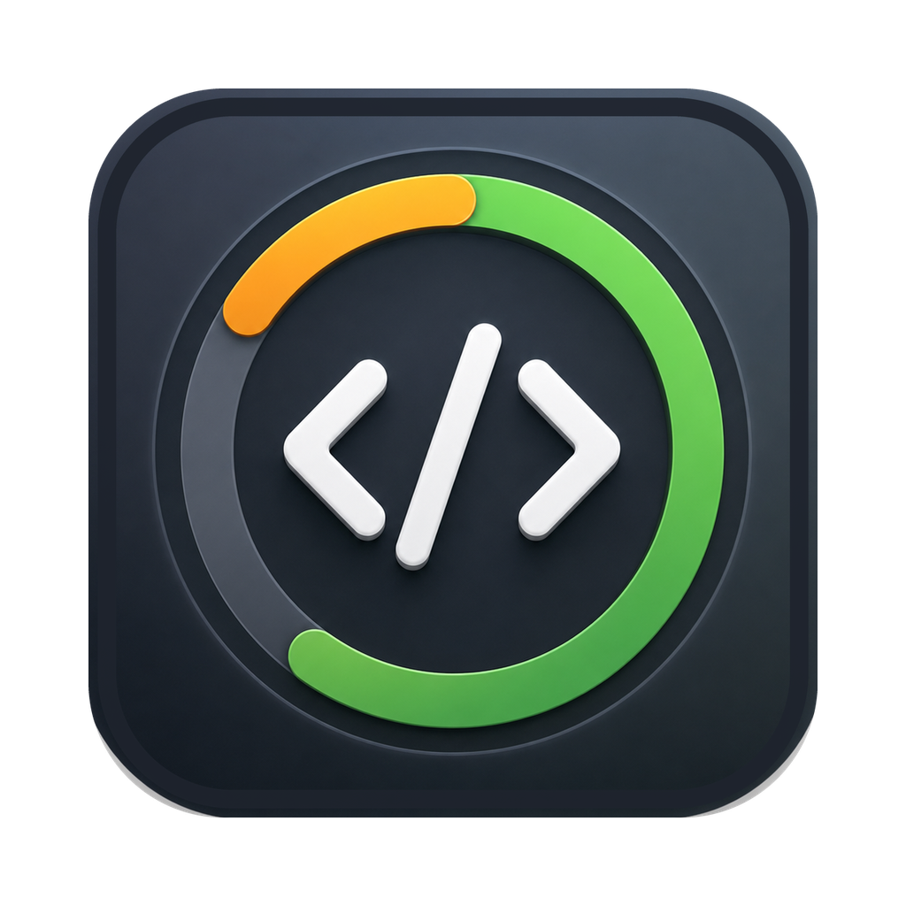
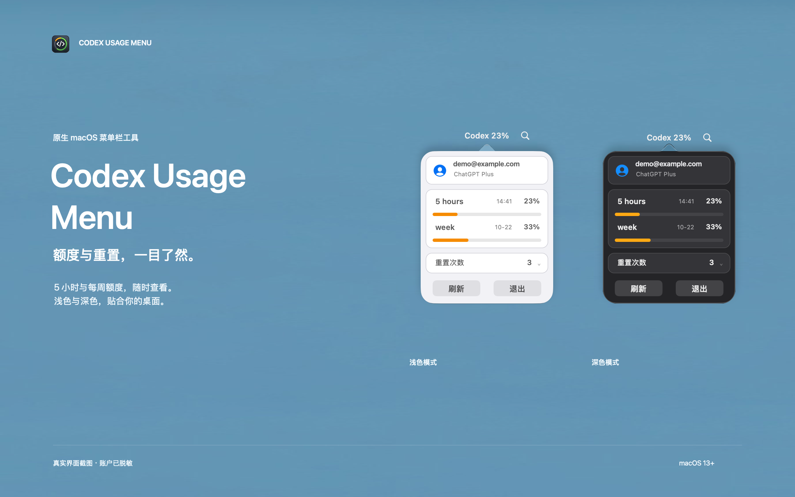
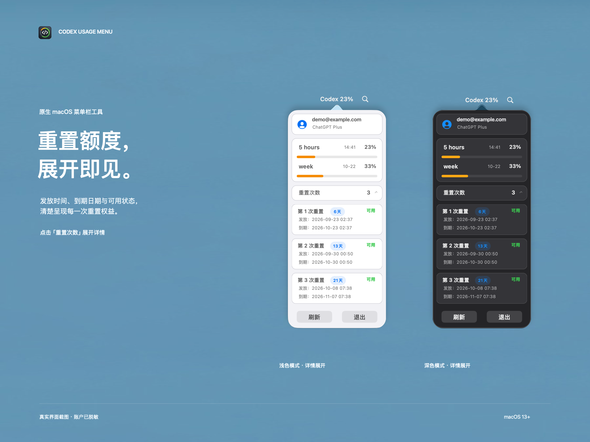

<p align="center">
  
</p>

<h1 align="center">Codex Usage Menu</h1>

<p align="center">额度与重置，一目了然。<br>在 macOS 菜单栏查看 Codex 的 5 小时与每周剩余额度。</p>

<p align="center">
  <a href="#安装与使用">安装与使用</a> ·
  <a href="#界面预览">界面预览</a> ·
  <a href="docs/README.en.md">English</a> ·
  <a href="docs/support.md">支持项目</a>
</p>

原生 AppKit 小工具，每分钟自动刷新，支持浅色与深色模式。独立社区项目，与 OpenAI 无隶属或背书关系。

- **菜单栏随时查看**：直接显示 5 小时窗口的剩余百分比。
- **两种额度集中展示**：查看 5 小时、每周余额及当地时区的重置时间。
- **展开重置详情**：查看服务端提供的重置权益、发放时间与到期状态。

## 界面预览

**额度概览 · 浅色与深色模式**



**重置详情 · 点击「重置次数」展开**



以上基于真实产品截图制作，账户已脱敏；数值和日期仅用于界面展示。菜单栏间距经过宣传排版调整。

## 安装与使用

### 1. 准备环境

| 依赖 | 要求 |
| --- | --- |
| macOS | 13 或更高版本 |
| Python | 3.9 或更高版本，打包后的应用运行时也需要 |
| Codex | 已安装并登录 ChatGPT 账户，且服务端提供 5 小时和每周额度 |
| 构建工具 | Xcode Command Line Tools；使用 Xcode 工程则需要 Xcode 16+ |

未安装命令行构建工具时，先运行 `xcode-select --install`。
应用会查找 PATH、常见 Homebrew 路径，以及 `/Applications` 中 Codex / ChatGPT 的内置运行时。

### 2. 构建并启动

```bash
git clone https://github.com/garycny/CodexUsageMenu.git
cd CodexUsageMenu
make app
open "apps/CodexUsageMenuBar/.build/Codex Usage.app"
```

可将生成的 `Codex Usage.app` 复制到 `~/Applications`。这是本机临时签名的开发构建；公开安装包的签名与公证流程见[打包说明](docs/packaging.md)。

### 3. 查看额度

1. 菜单栏的 `Codex 23%` 表示 **5 小时窗口还剩 23%**。
2. 点击菜单栏图标，查看两种额度与重置时间；每分钟自动更新，也可点击「刷新」。
3. 点击「重置次数」展开权益详情。此功能只展示信息，不会消耗重置权益。

未提供的数据会显示 `--`，不等于额度为 0。重置权益缺少到期日期时显示「暂不可用」。当前不含自动更新或开机自启设置。

## 常见问题

| 情况 | 处理方式 |
| --- | --- |
| 未找到 Codex 程序 | 安装 Codex CLI，或将 Codex / ChatGPT 放入 `/Applications` |
| 提示先登录 | 在 Codex 中登录 ChatGPT 账户，再点击「刷新」 |
| Python 未安装或启动失败 | 安装 Python 3.9+，用 `python3 --version` 检查；支持发现 Homebrew 安装的 Python |
| 读取超时或数据不可用 | 检查网络、登录状态；API Key 账户或不支持的额度窗口会显示 `--` |
| 重置次数显示 `--` | 服务端或账户未提供该字段，不能据此推断为 0 |

仍有问题时，请[提交 Issue](https://github.com/garycny/CodexUsageMenu/issues)，附 macOS 版本、复现步骤及脱敏截图。诊断命令见下方「开发与贡献」。

## 数据与隐私

额度由本机已安装的 Codex App Server 提供。应用不直接读取凭据文件或对话历史，不包含遥测或分析 SDK；认证与服务端请求由 Codex 处理。

本地快照保存在 `~/.codex/usage-menu/usage.json`，权限为 `0600`，可能包含邮箱、显示名、套餐及额度。反馈问题时请勿上传完整快照。读取失败或快照超过 3 分钟时，界面显示不可用。

详见[隐私说明](PRIVACY.md)与[快照格式](docs/usage-snapshot-schema.md)。

## 开发与贡献

欢迎反馈问题和提交 PR，开始前请阅读[贡献指南](CONTRIBUTING.md)。

```bash
make test          # Python 回归测试，不访问真实账户
make native-test   # macOS 原生读取与失败处理检查
make app           # 构建本机应用
make xcode-build   # 验证共享 Xcode scheme
```

<details>
<summary>诊断命令、开发配置与目录结构</summary>

命令行刷新快照：

```bash
python3 scripts/codex_usage.py snapshot
```

此命令会输出账户信息。反馈时只提供 `lastError.code` 和 `lastError.stage`，请勿粘贴完整输出。

- `--snapshot /path/to/usage.json` 或 `CODEX_USAGE_SNAPSHOT_PATH`：指定快照路径；原生应用也读取该环境变量。
- `CODEX_USAGE_HELPER_PATH`：开发时指定 helper。
- 当前支持 300 分钟和 10080 分钟的额度窗口；其他窗口显示不可用，避免误标。

```text
apps/CodexUsageMenuBar/   Objective-C / AppKit 应用与打包配置
scripts/codex_usage.py   App Server 通信与快照生成（仅 Python 标准库）
tests/                   Python 与原生回归检查
docs/                    英文说明、快照协议与发布指南
.github/                 CI 与 Issue / PR 模板
```

当前面向直接分发，Mac App Store 适配情况见[上架评估](docs/mac-app-store-readiness.md)。宣传素材的制作与复现见[素材说明](docs/assets/promo/README.md)。

</details>

<h2 align="center">支持项目</h2>

<p align="center">
  <strong>如果这个小工具对你有帮助，欢迎请我喝杯咖啡 ☕</strong><br>
  也欢迎 Star、反馈问题或提交 PR，一起让它更好用。
</p>

<p align="center">
  <a href="docs/support.md"></a>
</p>

<p align="center">
  打开微信扫一扫，或保存图片后在微信中识别。<br>
  打赏完全自愿，不影响任何功能或支持优先级。
</p>

## 许可证

Copyright 2026 garycny。代码和随仓库发布的项目素材使用 [Apache License 2.0](LICENSE)。第三方产品名称与商标的权利归各自所有者。
