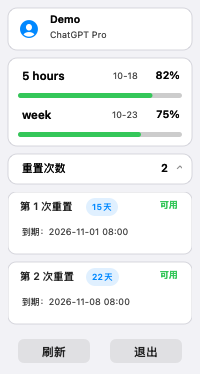
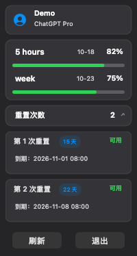

<p align="center">
  
</p>

# Codex Usage Menu

在 macOS 菜单栏查看 Codex 的 **5 小时 / 每周剩余额度和重置时间**。
原生 AppKit 界面，每分钟自动刷新，支持深色模式与可展开的重置额度详情。

独立社区项目，与 OpenAI 无隶属或背书关系。

[支持项目 / 微信打赏](docs/support.md) · [English](docs/README.en.md) · [贡献指南](CONTRIBUTING.md) · [隐私说明](PRIVACY.md) · [Apache-2.0](LICENSE)

## 界面预览

<p>
  
  
</p>

预览由真实 AppKit 界面使用演示数据生成，不包含真实账户信息。

## 使用要求

- macOS 13 或更高版本。
- Python 3.9 或更高版本；运行打包后的应用也需要安装 Python。
- 已安装并登录 Codex，且当前 ChatGPT 账户可通过 App Server 返回 5 小时和每周额度。
- 从源码构建需要 Xcode Command Line Tools（`xcode-select --install`）。使用 Xcode 工程需要 Xcode 16 或更高版本。

应用优先查找 PATH 中的 `codex`，也支持常见 Homebrew 路径和 `/Applications` 中的 Codex / ChatGPT 内置运行时。
API Key 账户、未登录账户或不提供这两个额度窗口的账户会显示 `--`。

## 从源码运行

```bash
git clone https://github.com/garycny/CodexUsageMenu.git
cd CodexUsageMenu
make app
open "apps/CodexUsageMenuBar/.build/Codex Usage.app"
```

这是本机临时签名的开发构建。可将应用复制到 `~/Applications`；其他 Mac 上的公开安装包应由维护者签名并公证，见[打包说明](docs/packaging.md)。

应用启动后在菜单栏显示 `Codex 82%`，该百分比代表 **5 小时窗口剩余量**。
点击打开面板，可查看每周余额、当地时区的重置时间，以及服务端提供的重置额度详情。
面板支持手动刷新和退出；当前不包含自动更新或开机自启功能。

“重置次数”是服务端单独提供的可用重置权益；本应用只展示信息，不会消耗重置权益。
缺少到期日期时显示“暂不可用”，缺少整个字段时显示 `--`。

## 数据与隐私

Python helper 通过官方 [Codex App Server](https://learn.chatgpt.com/docs/app-server) 调用
`account/read` 和 `account/rateLimits/read`，再把显示所需的数据写入本地快照：

```text
~/.codex/usage-menu/usage.json
```

快照可能包含邮箱、显示名、套餐及额度信息；文件权限为 `0600`，不要将其上传到 Issue。
本项目不直接读取凭据文件或对话历史，不提供 HTTP 服务，也不包含遥测或分析 SDK。
认证和服务端请求由已安装的 Codex 处理，详见[隐私说明](PRIVACY.md)。

读取失败会显示 `--`；临时错误自动重试一次。超过 3 分钟的快照不会作为有效额度显示。
目前仅展示 300 分钟和 10080 分钟窗口；若服务端返回其他窗口，显示不可用以避免误标。

## 常见问题

| 情况 | 处理方式 |
| --- | --- |
| 未找到 Codex 程序 | 安装 Codex CLI 或将 Codex / ChatGPT 放入 `/Applications`，确认 `codex --version` 可运行 |
| 请先在 Codex 中登录 | 在 Codex 登录 ChatGPT 账户，再点刷新 |
| Python 未安装或启动失败 | 安装 Python 3.9+，确认 `python3 --version`；Finder 启动可发现 Homebrew 的 Python |
| 读取超时或数据不可用 | 检查网络与登录状态；运行下面的快照命令，提供 `lastError.code` 和 `lastError.stage`，不要上传邮箱或完整快照 |
| 重置权益显示 `--` | 当前服务端或账户没有提供该字段；不能据此推断为 0 |

## 开发

```bash
make test          # Python 回归测试，不访问真实账户
make native-test   # macOS 原生读取与失败处理检查
make app           # 构建本机应用
make xcode-build   # 验证共享 Xcode scheme
```

命令行刷新（会输出账户显示信息，请勿直接粘贴完整输出）：

```bash
python3 scripts/codex_usage.py snapshot
```

可用 `--snapshot /path/to/usage.json` 或 `CODEX_USAGE_SNAPSHOT_PATH` 指定快照路径。
原生应用也读取 `CODEX_USAGE_SNAPSHOT_PATH`；开发时可用 `CODEX_USAGE_HELPER_PATH` 指定 helper。

```text
apps/CodexUsageMenuBar/   Objective-C / AppKit 应用与打包配置
scripts/codex_usage.py   App Server 通信与快照生成（仅 Python 标准库）
tests/                   Python 与原生回归检查
docs/                    英文说明、快照协议与发布指南
.github/                 CI 与 Issue / PR 模板
```

数据协议见[快照格式](docs/usage-snapshot-schema.md)。贡献前请阅读[贡献指南](CONTRIBUTING.md)。
当前面向直接分发，Mac App Store 仍需处理沙盒与外部运行时依赖。

## 支持项目

欢迎 Star、反馈问题或提交 PR。打赏完全自愿，不影响任何功能或支持优先级。
如果这个小工具对你有帮助，可以通过[微信打赏](docs/support.md)支持维护。

<a href="docs/support.md"></a>

## 许可证

Copyright 2026 garycny。代码和随仓库发布的项目素材使用 [Apache License 2.0](LICENSE)。
第三方产品名称与商标的权利归各自所有者。
